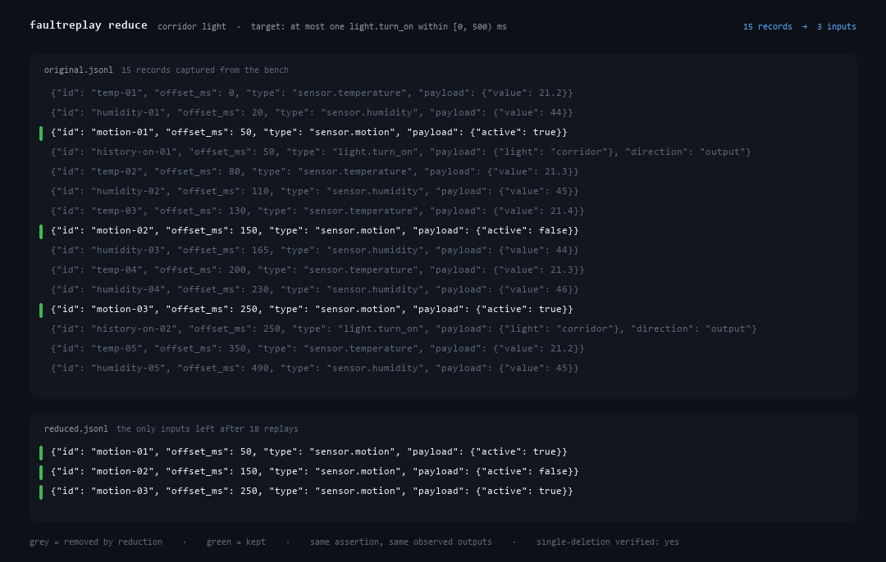

# FaultReplay Agent v0.1

FaultReplay Agent replays an event log against a target assertion, reduces it within a replay budget while preserving the same failure, and exports a pytest regression test.

[简体中文](README.zh-CN.md) · MIT



```sh
python -m pip install -e ".[test]"
faultreplay demo
```

Python 3.11 or newer. Once installed, both the demo and the tests run offline — no API key needed.

```text
Original log: 15 records (13 replay inputs)
Target: corridor.turn_on_once | light.turn_on [0, 500) ms <= 1
Status: complete; replays: 18/100
Report: faultreplay-output/report.md
Reduced inputs: 3 (motion-01, motion-02, motion-03)
Observed light.turn_on at [50, 250] ms (original) and [50, 250] ms (reduced)
Single-deletion verified: yes
Verify exported regression: python -m pytest -q "faultreplay-output/test_regression.py"
Reproduce on failing simulator: python -m pytest -q "faultreplay-output/test_regression.py" -p faultreplay.pytest_plugin --faultreplay-simulator faultreplay.corridor:BUGGY
```

## Verify the corridor light regression

The exported `test_regression.py` runs the same assertion against `original.jsonl` and `reduced.jsonl`: at most one `light.turn_on` within `[0, 500)` ms.

```sh
python -m pytest -q "faultreplay-output/test_regression.py"
python -m pytest -q "faultreplay-output/test_regression.py" -p faultreplay.pytest_plugin --faultreplay-simulator faultreplay.corridor:BUGGY
```

| Simulator | Light-on times, original and reduced logs | pytest result |
| --- | --- | --- |
| Fixed (the exported test's default) | 50 ms in both | `2 passed` |
| Buggy | 50 and 250 ms in both | `2 failed`, both violating `corridor.turn_on_once` |

To move the generated test into your own project, copy `original.jsonl`, `reduced.jsonl`, `initial_state.json` and `assertions.json` next to the test file, and install FaultReplay Agent plus the matching simulator adapter. The source example lives in `src/faultreplay/examples/corridor/`.

## Bring your own event log

[Try the standalone webhook example](examples/webhook-service/README.md) to start with an application module outside the installed package and run the generated regression against its buggy and fixed versions.

Each JSONL line carries a unique `id`, a non-negative integer `offset_ms`, an event `type` and an object `payload`. Write the log in ascending `offset_ms`; events sharing a timestamp run in file order. `direction` defaults to `input`. Mark past outputs with `"direction":"output"` so the report can show them. Every replay starts from a copy of the initial state at 0 ms, advances a virtual clock to each event's original offset and injects the input.

```jsonl
{"id":"motion-01","offset_ms":50,"type":"sensor.motion","payload":{"active":true}}
{"id":"history-on-01","offset_ms":50,"type":"light.turn_on","payload":{"light":"corridor"},"direction":"output"}
```

The initial state is a JSON object such as `{"motion": false}`. The assertion file holds one or more count assertions and names the failure to reproduce with `target_assertion_id`. `window_ms` includes its start and excludes its end.

```json
{
  "target_assertion_id": "corridor.turn_on_once",
  "assertions": [
    {"id": "corridor.turn_on_once", "output_type": "light.turn_on", "window_ms": [0, 500], "max_count": 1}
  ]
}
```

Define an instance of `faultreplay.replay.Adapter` in an importable Python module. Its `create(initial_state)` builds one simulator per replay. The simulator implements `handle(event, clock)`, reads the virtual time from `clock.now_ms` and emits output for that instant with `clock.emit(output_type, payload)`. The optional `validate_initial` and `validate_event` check your input before the first replay.

```sh
faultreplay reduce --events events.jsonl --initial-state initial_state.json --assertions assertions.json --simulator my_app.replay:BUGGY --regression-simulator my_app.replay:FIXED --max-replays 100 --output replay-result
```

`--regression-simulator` selects the adapter the exported test uses by default; without it, `--simulator` is reused. The CLI exits `0` when it exported a regression test, `1` when this run only produced a diagnostic report, and `2` on bad arguments, bad input or a write error.

## Models and replay budget

Add `--model my_app.model:suggest` to let a model propose removals. `suggest(system_prompt, message_json)` receives the runtime prompt along with the target assertion, the current event ids and summaries, the current observation and the latest replay results. It returns JSON text shaped like `{"remove_ids":["temp-01","temp-02"]}`. The program validates the suggestion and runs the replays itself. If the model cannot be loaded, raises, or suggests something invalid, a deterministic strategy takes over and tries event categories, contiguous spans and single-event deletions in turn.

`--max-replays` defaults to 100 and counts every actual replay: baseline, candidates and final verification. The baseline and each candidate run twice, comparing timing, type and content of the emitted events. A candidate must finish cleanly and violate the target assertion consistently; one that raises or disagrees between runs is marked undetermined. If the baseline does not reproduce reliably, the report records the original observation and stops. Two replays are reserved before each reduction round to re-verify the sequence finally chosen.

When the budget runs out, `report.md` lists the shortest sequence found and verified in that run and the deletion batches still unchecked, and flags any batch whose replays were undetermined. The report only says `Single-deletion verified: yes` when every single-event deletion of the current sequence produced a stable result without the target assertion failing.

## Development

```sh
python -m pytest -q
faultreplay demo --max-replays 8 --output faultreplay-output/budget-8
```

GitHub Actions runs the tests, the offline demo and the generated regression test on Python 3.11 and 3.12. The suite uses a stub model to exercise suggestions, replay feedback and the offline fallback, and it verifies that the exported test fails on the buggy simulator and passes on the fixed one.

## License

[MIT](LICENSE)
